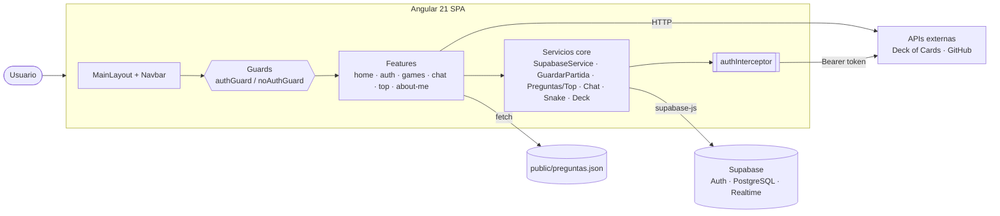
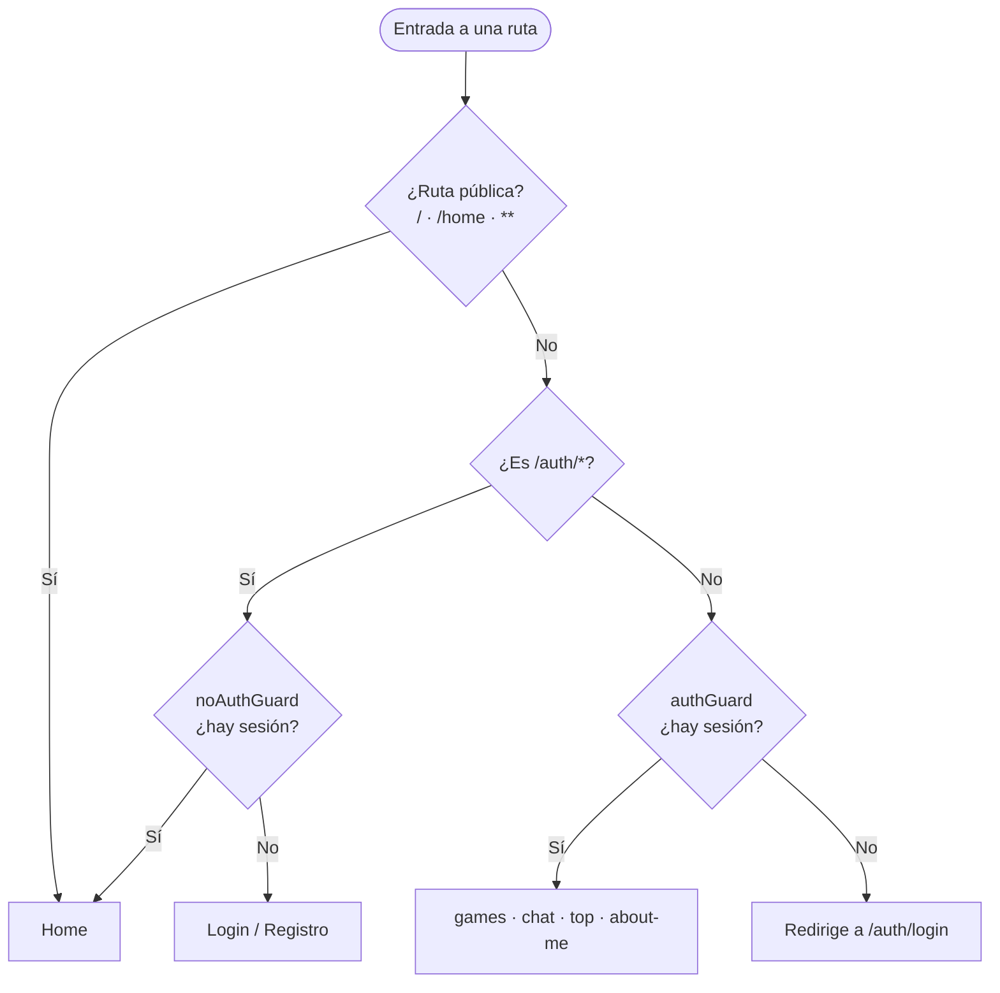
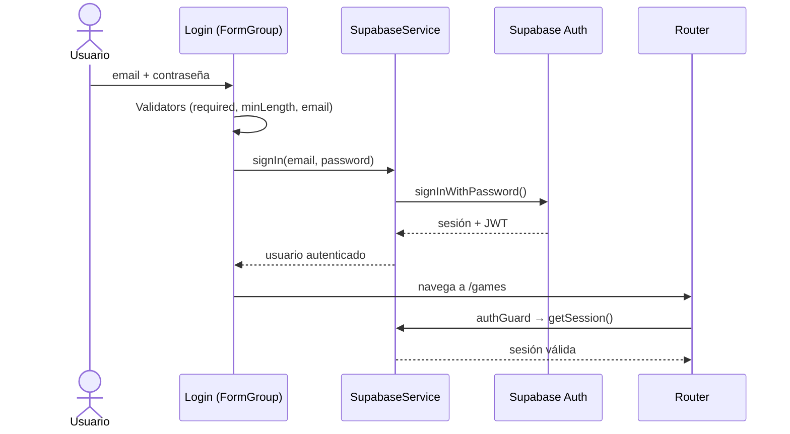
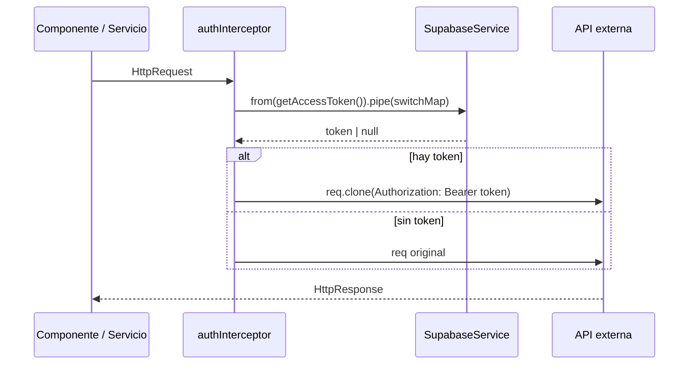
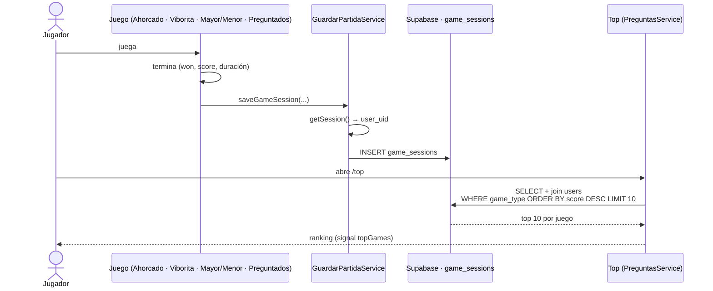
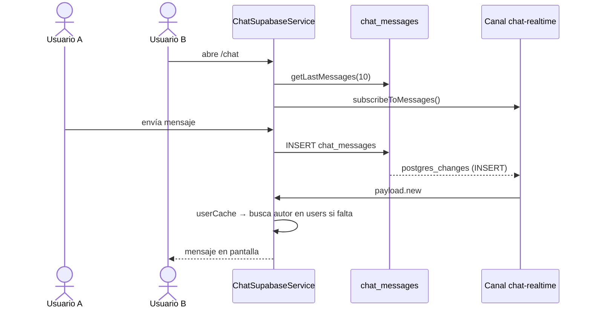
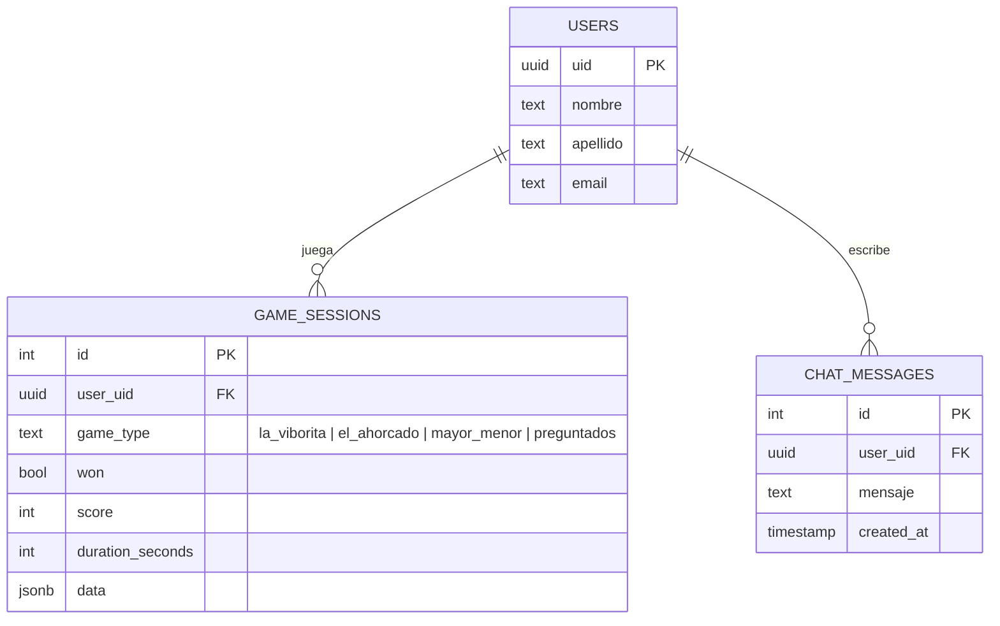

# 🎮 Arcade

Plataforma web de minijuegos con autenticación, chat en tiempo real y ranking global, construida con **Angular 21** y **Supabase**.


> Proyecto desarrollado para la materia **Programación IV**.

---

## 📑 Tabla de contenidos

- [Características](#-características)
- [Juegos](#-juegos)
- [Tecnologías](#-tecnologías)
- [Arquitectura](#-arquitectura)
- [Diagramas](#-diagramas)
- [Conceptos y patrones aplicados](#-conceptos-y-patrones-aplicados)
- [Rutas](#-rutas)
- [Requisitos previos](#-requisitos-previos)
- [Instalación y ejecución](#-instalación-y-ejecución)
- [Configuración de entorno](#-configuración-de-entorno)
- [Modelo de datos](#-modelo-de-datos)
- [Scripts disponibles](#-scripts-disponibles)
- [Seguridad](#-seguridad)
- [Autor](#-autor)

---

## ✨ Características

- **Autenticación** de usuarios (registro e inicio de sesión) mediante Supabase Auth.
- **Cuatro minijuegos** jugables desde el navegador.
- **Persistencia de partidas**: cada sesión de juego se guarda en la base de datos.
- **Ranking global (Top)** con los mejores puntajes.
- **Chat en tiempo real** entre usuarios autenticados.
- **Sección "Sobre mí"** que consume la API pública de GitHub.
- **Rutas protegidas** con guards (`authGuard` / `noAuthGuard`) y *lazy loading* de todas las vistas.
- **Interceptor HTTP** que adjunta el token de sesión a las peticiones.
- Interfaz responsive con **Tailwind CSS 4**.

## 🕹️ Juegos

| Juego | Descripción |
|-------|-------------|
| **Ahorcado** | Adivina la palabra letra por letra antes de agotar los intentos. |
| **La Viborita** | Clásico Snake: come, crece y evita chocar. |
| **Mayor o Menor** | Predice si la próxima carta del mazo será mayor o menor. |
| **Preguntados** | Trivia por categorías con preguntas cargadas desde `public/preguntas.json`. |

## 🧰 Tecnologías

- **Frontend:** Angular 21 (standalone components, lazy loading), TypeScript 5.9, RxJS 7.8
- **Estilos:** Tailwind CSS 4 + PostCSS
- **Backend as a Service:** Supabase (Auth, PostgreSQL, Realtime) vía `@supabase/supabase-js`
- **Testing:** Vitest + jsdom
- **Formato:** Prettier

## 🏗️ Arquitectura

```
src/app/
├── core/                    # Singletons de la aplicación
│   ├── guards/              # authGuard, noAuthGuard
│   ├── layouts/             # MainLayout (navbar + router-outlet)
│   ├── models/              # Interfaces (p. ej. pregunta.model.ts)
│   └── services/            # Auth, guardado de partidas, Snake, Preguntados, interceptor
├── features/                # Funcionalidades (cargadas de forma diferida)
│   ├── home/                # Landing: inicio, juegos, descarga
│   ├── auth/                # login y register
│   ├── games/               # listado + ahorcado, la-viborita, mayor-menor, preguntados
│   ├── chat/                # chat en tiempo real
│   ├── top/                 # ranking global
│   └── about-me/            # perfil con datos de GitHub
├── shared/components/       # navbar, card
└── environments/            # configuración de entorno
```

## 📐 Diagramas

Los diagramas están escritos en [Mermaid](https://mermaid.js.org/) y se renderizan directamente en GitHub.

### Arquitectura general



### Navegación y protección de rutas



### Flujo de autenticación



### Interceptor HTTP



### Ciclo de una partida y ranking



### Chat en tiempo real



### Modelo de datos



## 🧩 Conceptos y patrones aplicados

| Concepto | Dónde se usa |
|----------|--------------|
| **Lazy loading** (`loadComponent` / `loadChildren`) | Todas las vistas y el módulo de rutas de `auth` se cargan bajo demanda en `app.routes.ts`. |
| **Standalone components** | Toda la app, sin `NgModule`; cada componente declara sus propios `imports`. |
| **Route guards funcionales** | `authGuard` protege juegos, chat, top y about-me; `noAuthGuard` evita que un usuario logueado vea login/registro. |
| **HTTP Interceptor funcional** | `authInterceptor` (`provideHttpClient(withInterceptors(...))`) agrega el token de sesión de Supabase a cada petición. |
| **Pipeline RxJS (`pipe`)** | El interceptor convierte la promesa del token con `from(...).pipe(...)` y clona la request con el header `Authorization`. |
| **Signals** (`signal`, `computed`, `effect`) | Estado reactivo en auth, chat, Ahorcado, Mayor o Menor y About-me. |
| **Nuevo control flow** (`@if`, `@for`, `@switch`) | Plantillas de login, registro, chat, top, navbar y los cuatro juegos. |
| **Inyección de dependencias con `inject()`** | Servicios, `Router`, `HttpClient` y `NgZone` en componentes, guards e interceptor. |
| **Servicios `providedIn: 'root'`** | Auth, guardado de partidas, chat, ranking, mazo, preguntas, Snake y GitHub. |
| **Formularios reactivos** | Login y registro con `FormGroup`, `FormControl` y `Validators` (`required`, `minLength`, `email`). |
| **`@Input` en componentes reutilizables** | `card` recibe `titulo`, `imagen` y `ruta`; se reutiliza en home y listado de juegos. |
| **Layout con rutas hijas** | `MainLayout` envuelve todas las rutas con la navbar y un `router-outlet`. |
| **Supabase Realtime** | Canal `chat-realtime` para recibir mensajes sin recargar. |
| **Consumo de APIs REST** | [Deck of Cards API](https://deckofcardsapi.com/) (Mayor o Menor) y GitHub API (About-me). |
| **Datos estáticos en JSON** | Banco de preguntas por categoría en `public/preguntas.json`. |
| **Game loop y eventos de teclado** | La Viborita y Ahorcado usan temporizadores, `keydown` y `NgZone` para controlar la detección de cambios. |

## 🧭 Rutas

| Ruta | Acceso | Descripción |
|------|--------|-------------|
| `/`, `/home` | Público | Página de inicio |
| `/auth/login`, `/auth/register` | Solo no autenticados | Acceso y registro |
| `/games` | Autenticado | Listado de juegos |
| `/games/ahorcado` | Autenticado | Ahorcado |
| `/games/la-viborita` | Autenticado | Snake |
| `/games/mayor-menor` | Autenticado | Mayor o Menor |
| `/games/preguntados` | Autenticado | Preguntados |
| `/chat` | Autenticado | Chat en tiempo real |
| `/top` | Autenticado | Ranking de jugadores |
| `/about-me` | Autenticado | Sobre el autor |

## ✅ Requisitos previos

- [Node.js](https://nodejs.org/) 20.19+ (recomendado LTS)
- npm 10+
- Un proyecto en [Supabase](https://supabase.com/) (gratuito)

## 🚀 Instalación y ejecución

```bash
# 1. Clonar el repositorio
git clone <url-del-repositorio>
cd arcade

# 2. Instalar dependencias
npm install

# 3. Configurar el entorno (ver sección siguiente)

# 4. Levantar el servidor de desarrollo
npm start
```

La aplicación quedará disponible en **http://localhost:4200/** con recarga automática.

## 🔐 Configuración de entorno

Edita `src/app/environments/environment.ts`:

```ts
export const environment = {
    production: false,
    supabaseUrl: 'https://<tu-proyecto>.supabase.co',
    supabaseKey: '<tu-anon-public-key>',
    tokenGithub: '<opcional: token de GitHub sin permisos especiales>'
};
```

- `supabaseUrl` y `supabaseKey` se obtienen en **Project Settings → API** de Supabase. Usa siempre la clave **anon/public**, nunca la `service_role`.
- `tokenGithub` es opcional: solo evita el límite de peticiones anónimas de la API de GitHub.

## 🗄️ Modelo de datos

Tablas de Supabase que utiliza la aplicación:

| Tabla | Uso |
|-------|-----|
| `users` | Datos de perfil de los usuarios registrados. |
| `game_sessions` | Partidas jugadas (juego, puntaje, usuario); alimenta el ranking. |
| `chat_messages` | Mensajes del chat en tiempo real. |

Habilita **Realtime** sobre `chat_messages` y define políticas **Row Level Security (RLS)** para las tres tablas.

## 📜 Scripts disponibles

| Comando | Descripción |
|---------|-------------|
| `npm start` | Servidor de desarrollo (`ng serve`). |
| `npm run build` | Compilación de producción en `dist/`. |
| `npm run watch` | Compilación en modo desarrollo con *watch*. |
| `npm test` | Tests unitarios con Vitest. |

## 🛡️ Seguridad

- No subas claves ni tokens reales al repositorio. Mantén los valores sensibles fuera del control de versiones (por ejemplo, un `environment.ts` local ignorado en `.gitignore` y un `environment.example.ts` versionado).
- La clave `anon` de Supabase es pública por diseño, pero su seguridad depende de configurar correctamente las políticas RLS.
- Si un token de GitHub fue expuesto, **revócalo** y genera uno nuevo.

## 👤 Autor

**Juan Manuel** — [@juanma7882](https://github.com/juanma7882)

---

<p align="center">Hecho con ❤️ y Angular</p>
